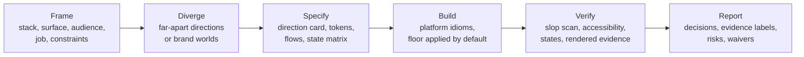

# Pixelcraft

Portable Agent Skills for distinctive, evidence-verified UI and rigorous UX across frontend stacks.

Pixelcraft is an open-source skill pack for coding agents. It helps agents move beyond interchangeable “AI-generated” interfaces by forcing design divergence before implementation, applying a cross-platform UX/accessibility floor, translating decisions idiomatically into the target stack, and reporting what was actually verified.

## Why Pixelcraft exists

LLM-generated interfaces often converge on the same visual and interaction patterns: centered heroes, generic gradients, default fonts, decorative cards, template copy, shallow states, and web-centric assumptions. The evidence base in [`docs/RESEARCH.md`](docs/RESEARCH.md) connects this to output homogenization and mode collapse, while also documenting gaps in current skill ecosystems: heavy TypeScript/web bias, weak UX state coverage, inconsistent accessibility handling, and overconfident verification claims.

Pixelcraft treats this as a process problem rather than a prompt slogan. It does not merely say “make it beautiful”; it changes how the agent frames, diverges, specifies, builds, verifies, and reports UI work.

## What makes it different

- **Divergence before commitment:** generate multiple materially different directions or brand worlds, score them, select one, and record why alternatives lost.
- **A mandatory floor:** accessibility, interaction, adaptation, localization, performance, state completeness, truthfulness, coherence, and evidence labeling are default constraints—not later cleanup.
- **Any frontend stack:** web, server-rendered UI, mobile, Python UI, desktop, TUI, email, and game UI receive framework-specific guidance rather than copied web assumptions.
- **Honest verification:** findings are labeled `rendered`, `static`, `model-judgment`, `not-checked`, or `waived`. A successful build or page load is not presented as proof of visual quality.
- **Portable packaging:** skills follow the Agent Skills format and can be installed across multiple coding-agent hosts.

## The loop



The full architecture is documented in [`docs/ARCHITECTURE.md`](docs/ARCHITECTURE.md).

## Skills

| Skill | Purpose |
|---|---|
| `pixelcraft` | Orchestrator: stack/surface detection, mode classification, six-step loop, mandatory floor, evidence-labeled reporting |
| `pixelcraft-direction` | Divergent visual direction, scoring, direction cards, repetition history, anti-slop fingerprints, design movements |
| `pixelcraft-craft` | Typography, color, layout, motion, imagery, and icon craft across platforms |
| `pixelcraft-tokens` | DTCG token structure and multi-platform token export |
| `pixelcraft-ux` | JTBD, flows, information architecture, state matrices, forms, feedback, i18n UX, UX writing |
| `pixelcraft-accessibility` | WCAG 2.2 AA floor translated into concrete platform checks and verification methods |
| `pixelcraft-review` | Audit/critique/polish modes, severity taxonomy, Nielsen checks, persona walkthroughs, slop scanning |
| `pixelcraft-web` | HTML/CSS, React/Next, Vue/Nuxt, Svelte, Solid, Angular, Astro, Qwik, htmx/Alpine, Lit, Tailwind, server-rendered web |
| `pixelcraft-mobile` | SwiftUI, UIKit, Jetpack Compose, Flutter, React Native/Expo, Kotlin Multiplatform, Ionic/Capacitor, .NET MAUI |
| `pixelcraft-python-ui` | Streamlit, Gradio, Reflex, NiceGUI, Dash, Panel, Shiny, Flet, Kivy, Jupyter widgets |
| `pixelcraft-desktop` | Tauri, Electron, Qt/PySide/QML, WinUI/WPF, AppKit, GTK, Avalonia, Rust GUI |
| `pixelcraft-tui` | Textual, Rich, Ink, Bubble Tea/Lip Gloss, Ratatui |
| `pixelcraft-email` | Table HTML email, MJML, React Email, client quirks, dark mode, image blocking, plaintext |
| `pixelcraft-game-ui` | Unity UI Toolkit, Godot, Unreal UMG, HUD principles |
| `pixelcraft-brandkit` | Brand kits, identity boards, logo systems, moodboards, visual-world presentations, brand-specific prompting and QA |

## Supported stacks

| Surface | Coverage |
|---|---|
| Web | HTML/CSS, React/Next.js, Vue/Nuxt, Svelte/SvelteKit, Solid, Angular, Astro, Qwik, htmx/Alpine, Lit/Web Components, Tailwind CSS v4 |
| Server-rendered | Rails/Hotwire, Laravel Blade/Livewire, Django/Jinja, Phoenix LiveView, Blazor, Go templ/templates |
| Mobile | SwiftUI, UIKit, Jetpack Compose, Flutter, React Native/Expo, Kotlin Multiplatform, Ionic/Capacitor, .NET MAUI |
| Python UI | Streamlit, Gradio, Reflex, NiceGUI, Dash, Panel, Shiny for Python, Flet, Kivy, Jupyter widgets |
| Desktop | Tauri, Electron, Qt/PySide/QML, WinUI/WPF, AppKit, GTK/libadwaita, Avalonia, egui/Slint/Dioxus/iced |
| Terminal | Textual, Rich, Ink, Bubble Tea/Lip Gloss, Ratatui |
| Email | HTML tables, MJML, React Email, Outlook/Gmail/Apple Mail constraints |
| Game UI | Unity UI Toolkit, Godot Control/Theme, Unreal UMG/Slate/CommonUI, HUD/focus/safe-area principles |
| Identity | Brand-kit and visual-world generation workflows with token handoff |

## Install

### Pixelcraft installer

Install all skills into the current project for one host:

```bash
npx pixelcraft add all --agent claude
```

Install selected skills:

```bash
npx pixelcraft add pixelcraft pixelcraft-web pixelcraft-review --agent codex
```

Install user-level/global skills:

```bash
npx pixelcraft add all --agent claude --global
```

Preview without writing files:

```bash
npx pixelcraft add all --agent all --dry-run
```

Replace an existing installation explicitly (without `--force`, existing skill directories are skipped so local edits are not silently deleted):

```bash
npx pixelcraft add all --agent claude --force
```

The installer refuses symlinked target skill directories rather than following them outside the project.

List bundled skills:

```bash
npx pixelcraft list
```

Supported installer targets and project paths:

| `--agent` value | Project installation path |
|---|---|
| `claude` | `.claude/skills` |
| `codex` | `.agents/skills` |
| `agents` | `.agents/skills` |
| `cursor` | `.cursor/skills` |
| `gemini` | `.gemini/skills` |
| `copilot` | `.github/skills` |
| `all` | all of the above, with duplicate `.agents/skills` deduplicated |

With `--global`, the installer uses `~/.claude/skills`, `~/.agents/skills`, `~/.cursor/skills`, `~/.gemini/skills`, or `~/.copilot/skills` as implemented in `bin/pixelcraft.mjs`. Host behavior changes quickly; verify current host documentation before automating around global paths.

### Vercel skills CLI

```bash
npx skills add ThanhNguyxn07/Pixelcraft
```

This uses the external `skills` CLI's repository discovery/install behavior.

### Claude Code plugin marketplace

Inside Claude Code:

```text
/plugin marketplace add ThanhNguyxn07/Pixelcraft
```

The repository includes `.claude-plugin/marketplace.json` with the `pixelcraft` plugin and all bundled skill paths.

### Manual copy

Copy any self-contained directory under `skills/` into the target host directory—for example, `skills/pixelcraft-web` into `.claude/skills/pixelcraft-web`, `.agents/skills/pixelcraft-web`, `.cursor/skills/pixelcraft-web`, `.gemini/skills/pixelcraft-web`, or `.github/skills/pixelcraft-web`. Do not construct cross-skill relative links after copying; each skill folder is self-contained.

## Example prompts

```text
Use Pixelcraft to redesign this repository's settings screen. Detect the stack first, generate divergent directions, implement the selected direction idiomatically, and report verification evidence.
```

```text
Audit this checkout flow with pixelcraft-review. Separate floor violations from polish findings and label rendered evidence versus static inference.
```

```text
Build the dashboard empty, loading, error, offline, and permission-denied states using pixelcraft-ux and the matching platform skill.
```

```text
Create a premium brand-kit identity board for a developer-tool startup. Use pixelcraft-brandkit, compare distinct brand worlds before prompting, and export the selected palette/type as DTCG tokens.
```

```text
Adapt this landing page for Arabic and German. Check RTL behavior, expansion, locale formatting, font fallback, and localized copy rather than only translating strings.
```

## Tools

Validate all skill metadata, line limits, scripts, and local links:

```bash
npm run validate
```

Scan a directory for recurring AI-slop fingerprints:

```bash
node skills/pixelcraft-review/scripts/slop-scan.mjs <directory>
node skills/pixelcraft-review/scripts/slop-scan.mjs <directory> --json
```

Export the example DTCG tokens:

```bash
node skills/pixelcraft-tokens/scripts/export-tokens.mjs skills/pixelcraft-tokens/assets/tokens.example.json --format css
node skills/pixelcraft-tokens/scripts/export-tokens.mjs skills/pixelcraft-tokens/assets/tokens.example.json --format all --out-dir generated/tokens
```

Supported export formats are `css`, `tailwind`, `swift`, `kotlin`, `dart`, `python`, `qt`, `textual`, and `all`.

Inspect installer behavior:

```bash
node bin/pixelcraft.mjs --help
node bin/pixelcraft.mjs add all --agent all --dry-run
```

## Repository layout

```text
bin/                         zero-dependency installer
scripts/                     validation tooling
skills/                      self-contained Agent Skills
docs/ARCHITECTURE.md         system design and conventions
docs/RESEARCH.md             cited evidence base
.claude-plugin/              Claude marketplace metadata
.github/workflows/           validation workflow
```

## Roadmap

- evaluation corpus for visual distinctiveness, UX completeness, accessibility, localization, and cross-platform fidelity;
- showcase site with verified examples across supported stacks;
- deeper framework coverage and version-specific verification matrices;
- richer design-token conversion and implementation handoff;
- calibrated review fixtures with known good/bad examples;
- internationalization of contributor documentation where useful, while keeping skill content consistently machine-readable.

## Contributing

See [`CONTRIBUTING.md`](CONTRIBUTING.md) and [`AGENTS.md`](AGENTS.md). Contributions must preserve the Agent Skills format, zero-dependency tooling, self-contained skill folders, evidence-label discipline, and the distinction between verified facts and model judgment.

## License

MIT — see [`LICENSE`](LICENSE).
